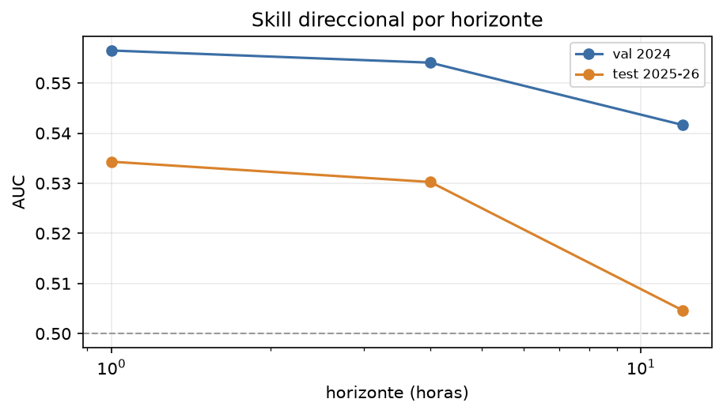
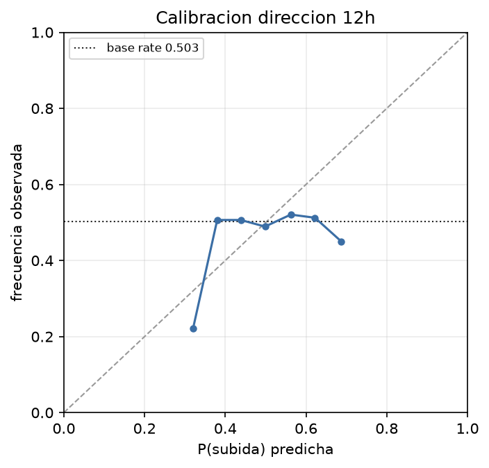
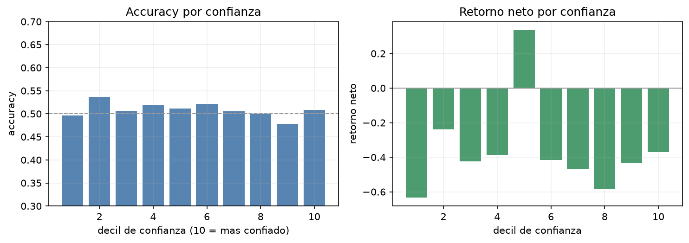
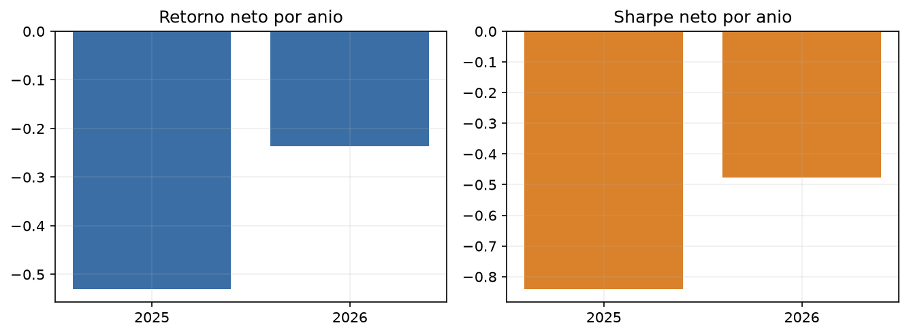

# Stage 0: señal direccional a 12h (máximo)

Generado: `2026-10-19T03:18:36+00:00`  
Config: `configs/direction.yaml` · costos: 10.0 bps round trip  
Train: BTCUSDT, ETHUSDT · Eval: BTCUSDT, ETHUSDT, SOLUSDT · Horizontes: 1h, 4h, 12h

Objetivo: decidir si hay evidencia de skill direccional antes de gastar GPU. Modelos tabulares baratos, long/short en futuros, sin funding (Stage 0).

## 1. Datos y targets

| horizon_h | symbol | split | h_bars | h_hours | n | up_rate | deadband_frac | first | last |
|---|---|---|---|---|---|---|---|---|---|
| 1.0000 | BTCUSDT | train | 4 | 1.0000 | 54,930 | 0.5090 | 0.3930 | 2017-09-16 14:00:00+00:00 | 2023-12-31 22:45:00+00:00 |
| 1.0000 | BTCUSDT | val | 4 | 1.0000 | 8,058 | 0.5076 | 0.4123 | 2024-01-31 03:45:00+00:00 | 2024-12-31 22:00:00+00:00 |
| 1.0000 | BTCUSDT | test | 4 | 1.0000 | 14,586 | 0.5025 | 0.4212 | 2025-01-31 03:45:00+00:00 | 2026-09-30 22:00:00+00:00 |
| 1.0000 | ETHUSDT | train | 4 | 1.0000 | 54,708 | 0.5061 | 0.4086 | 2017-09-16 14:00:00+00:00 | 2023-12-31 22:00:00+00:00 |
| 1.0000 | ETHUSDT | val | 4 | 1.0000 | 8,057 | 0.5125 | 0.4077 | 2024-01-31 03:45:00+00:00 | 2024-12-31 22:30:00+00:00 |
| 1.0000 | ETHUSDT | test | 4 | 1.0000 | 14,579 | 0.5079 | 0.4079 | 2025-01-31 03:45:00+00:00 | 2026-09-30 22:30:00+00:00 |
| 1.0000 | SOLUSDT | test | 4 | 1.0000 | 14,476 | 0.5028 | 0.4204 | 2025-01-31 03:45:00+00:00 | 2026-09-30 22:15:00+00:00 |
| 4.0000 | BTCUSDT | train | 16 | 4.0000 | 13,734 | 0.5133 | 0.2880 | 2017-09-16 14:00:00+00:00 | 2023-12-31 16:30:00+00:00 |
| 4.0000 | BTCUSDT | val | 16 | 4.0000 | 2,014 | 0.5214 | 0.3029 | 2024-01-31 03:45:00+00:00 | 2024-12-31 17:00:00+00:00 |
| 4.0000 | BTCUSDT | test | 16 | 4.0000 | 3,646 | 0.4992 | 0.3190 | 2025-01-31 03:45:00+00:00 | 2026-09-30 16:00:00+00:00 |
| 4.0000 | ETHUSDT | train | 16 | 4.0000 | 13,690 | 0.5057 | 0.3048 | 2017-09-16 14:00:00+00:00 | 2023-12-31 19:30:00+00:00 |
| 4.0000 | ETHUSDT | val | 16 | 4.0000 | 2,014 | 0.5094 | 0.3133 | 2024-01-31 03:45:00+00:00 | 2024-12-31 16:30:00+00:00 |
| 4.0000 | ETHUSDT | test | 16 | 4.0000 | 3,646 | 0.5093 | 0.3168 | 2025-01-31 03:45:00+00:00 | 2026-09-30 19:15:00+00:00 |
| 4.0000 | SOLUSDT | test | 16 | 4.0000 | 3,633 | 0.5045 | 0.3248 | 2025-01-31 03:45:00+00:00 | 2026-09-30 17:30:00+00:00 |
| 12.0000 | BTCUSDT | train | 48 | 12.0000 | 4,578 | 0.5175 | 0.2857 | 2017-09-16 14:00:00+00:00 | 2023-12-31 02:00:00+00:00 |
| 12.0000 | BTCUSDT | val | 48 | 12.0000 | 671 | 0.5320 | 0.3055 | 2024-01-31 03:45:00+00:00 | 2024-12-31 04:30:00+00:00 |
| 12.0000 | BTCUSDT | test | 48 | 12.0000 | 1,215 | 0.4988 | 0.3021 | 2025-01-31 03:45:00+00:00 | 2026-09-30 04:00:00+00:00 |
| 12.0000 | ETHUSDT | train | 48 | 12.0000 | 4,566 | 0.5079 | 0.2996 | 2017-09-16 14:00:00+00:00 | 2023-12-31 11:00:00+00:00 |
| 12.0000 | ETHUSDT | val | 48 | 12.0000 | 671 | 0.5410 | 0.2861 | 2024-01-31 03:45:00+00:00 | 2024-12-31 04:45:00+00:00 |
| 12.0000 | ETHUSDT | test | 48 | 12.0000 | 1,215 | 0.5160 | 0.3037 | 2025-01-31 03:45:00+00:00 | 2026-09-30 06:00:00+00:00 |
| 12.0000 | SOLUSDT | test | 48 | 12.0000 | 1,213 | 0.4946 | 0.3166 | 2025-01-31 03:45:00+00:00 | 2026-09-30 08:30:00+00:00 |

Muestreo no solapado (una fila cada h barras). La etiqueta de `t` usa `close[t+h]`; se purga si `t+h` cae en otro split. `deadband_frac` es la fracción que queda fuera de la zona muerta (movimientos chicos).

## 2. Resumen por horizonte

| horizon_h | modelo | auc_val | auc_test | auc_dead | thr | sharpe_thr | q_conf | conf_val_sharpe | conf_test_sharpe | conf_test_gross | conf_test_return | conf_trades | gate_thr |
|---|---|---|---|---|---|---|---|---|---|---|---|---|---|
| 1.0000 | hgb | 0.5565 | 0.5343 | 0.5291 | 0.1000 | -2.8525 | 0.1000 | -1.4503 | -2.8697 | 1.3019 | -0.8636 | 7,391 | FAIL |
| 4.0000 | hgb | 0.5541 | 0.5302 | 0.5110 | 0.0200 | -0.9453 | 0.1000 | 0.3886 | 0.5074 | 1.6607 | 0.4525 | 2,154 | FAIL |
| 12.0000 | hgb | 0.5416 | 0.5046 | 0.4992 | 0.1000 | -0.6186 | 0.2000 | 1.6580 | -0.6641 | -0.2073 | -0.7019 | 1,312 | FAIL |

## 3. Clasificación

| horizon_h | split | n | auc | balanced_acc | brier | ece | accuracy | up_rate |
|---|---|---|---|---|---|---|---|---|
| 1.0000 | val | 16,115 | 0.5565 | 0.5377 | 0.2476 | 0.0078 | 0.5387 | 0.5100 |
| 1.0000 | test | 43,641 | 0.5343 | 0.5233 | 0.2500 | 0.0258 | 0.5238 | 0.5044 |
| 4.0000 | val | 4,028 | 0.5541 | 0.5311 | 0.2473 | 0.0133 | 0.5323 | 0.5154 |
| 4.0000 | test | 10,925 | 0.5302 | 0.5204 | 0.2503 | 0.0286 | 0.5207 | 0.5043 |
| 12.0000 | val | 1,342 | 0.5416 | 0.5232 | 0.2487 | 0.0366 | 0.5238 | 0.5365 |
| 12.0000 | test | 3,643 | 0.5046 | 0.5083 | 0.2540 | 0.0481 | 0.5084 | 0.5032 |

El target es el signo del retorno forward. `auc` mide skill de ranking; `balanced_acc` corrige el desbalance; `ece` es el error de calibración.

## 4. Modelos (selección en validación)

Horizonte principal: **12h**. Modelo elegido: **hgb** `{'label': 'lr=0.03,leaves=7,min=200', 'params': HGBParams(learning_rate=0.03, max_leaf_nodes=7, min_samples_leaf=200, l2_regularization=1.0, max_iter=300)}`.

| modelo | params | val_auc | val_brier |
|---|---|---|---|
| hgb | lr=0.03,leaves=7,min=200 | 0.5416 | 0.2487 |
| hgb | lr=0.03,leaves=15,min=100 | 0.5381 | 0.2507 |
| logistic | C=1.0 | 0.5351 | 0.2486 |
| hgb | lr=0.03,leaves=7,min=100 | 0.5347 | 0.2494 |
| logistic | C=0.1 | 0.5346 | 0.2484 |
| logistic | C=0.01 | 0.5314 | 0.2483 |
| hgb | lr=0.03,leaves=15,min=200 | 0.5308 | 0.2520 |
| hgb | lr=0.1,leaves=7,min=200 | 0.5280 | 0.2550 |

## 5. Backtest neto (12h)

Costo base: 10.0 bps round trip. Umbral de probabilidad elegido en validación: **0.100** (P(subida) > 0.5+t long, P(subida) < 0.5-t short).

| threshold | n_periods | total_return | sharpe | max_drawdown | mean_period | vol_period | trades | exposure | hit_rate | profit_factor | avg_win | avg_loss | turnover |
|---|---|---|---|---|---|---|---|---|---|---|---|---|---|
| 0.0000 | 3,549 | -0.9665 | -0.8250 | -0.9752 | -6.96e-04 | 0.0228 | 1,669 | 1.0000 | 0.5084 | 0.9091 | 0.0153 | -0.0165 | 0.9160 |
| 0.0200 | 3,549 | -0.9347 | -0.7526 | -0.9486 | -5.63e-04 | 0.0202 | 2,187 | 0.7840 | 0.5074 | 0.9196 | 0.0155 | -0.0164 | 0.8732 |
| 0.0500 | 3,549 | -0.9224 | -0.9757 | -0.9473 | -5.87e-04 | 0.0163 | 2,153 | 0.4793 | 0.5006 | 0.8792 | 0.0158 | -0.0172 | 0.6890 |
| 0.1000 | 3,549 | -0.5918 | -0.6186 | -0.6742 | -2.10e-04 | 0.0092 | 840 | 0.1334 | 0.5062 | 0.8517 | 0.0159 | -0.0182 | 0.2394 |

### Long-only

| threshold | n_periods | total_return | sharpe | max_drawdown | mean_period | vol_period | trades | exposure | hit_rate | profit_factor | avg_win | avg_loss | turnover |
|---|---|---|---|---|---|---|---|---|---|---|---|---|---|
| 0.0000 | 3,549 | -0.8300 | -0.5064 | -0.9085 | -3.37e-04 | 0.0180 | 1,669 | 0.5122 | 0.5113 | 0.9384 | 0.0164 | -0.0180 | 0.4581 |
| 0.0200 | 3,549 | -0.5163 | -0.1208 | -0.7676 | -7.26e-05 | 0.0162 | 1,597 | 0.4085 | 0.5202 | 0.9984 | 0.0170 | -0.0180 | 0.4384 |
| 0.0500 | 3,549 | -0.6237 | -0.3786 | -0.7785 | -1.86e-04 | 0.0133 | 1,322 | 0.2646 | 0.5093 | 0.9452 | 0.0175 | -0.0185 | 0.3629 |
| 0.1000 | 3,549 | -0.5019 | -0.5244 | -0.6472 | -1.62e-04 | 0.0083 | 560 | 0.0887 | 0.5046 | 0.8372 | 0.0177 | -0.0207 | 0.1537 |

### Sensibilidad a costos del umbral

| round_trip_bps | n_periods | total_return | sharpe | max_drawdown | mean_period | vol_period | trades | exposure | hit_rate | profit_factor | avg_win | avg_loss | turnover |
|---|---|---|---|---|---|---|---|---|---|---|---|---|---|
| 0.0000 | 3,549 | -0.3767 | -0.2680 | -0.5473 | -9.10e-05 | 0.0092 | 840 | 0.1334 | 0.5062 | 0.9014 | 0.0160 | -0.0182 | 0.2394 |
| 2.0000 | 3,549 | -0.4273 | -0.3382 | -0.5761 | -1.15e-04 | 0.0092 | 840 | 0.1334 | 0.5062 | 0.8912 | 0.0160 | -0.0182 | 0.2394 |
| 4.0000 | 3,549 | -0.4738 | -0.4084 | -0.6031 | -1.39e-04 | 0.0092 | 840 | 0.1334 | 0.5062 | 0.8812 | 0.0159 | -0.0183 | 0.2394 |
| 5.0000 | 3,549 | -0.4956 | -0.4435 | -0.6159 | -1.51e-04 | 0.0092 | 840 | 0.1334 | 0.5062 | 0.8762 | 0.0159 | -0.0183 | 0.2394 |
| 10.0000 | 3,549 | -0.5918 | -0.6186 | -0.6742 | -2.10e-04 | 0.0092 | 840 | 0.1334 | 0.5062 | 0.8517 | 0.0159 | -0.0182 | 0.2394 |
| 20.0000 | 3,549 | -0.7328 | -0.9681 | -0.7655 | -3.29e-04 | 0.0092 | 840 | 0.1334 | 0.5062 | 0.8048 | 0.0158 | -0.0183 | 0.2394 |

## 5b. Ventanas de alta direccionalidad (top-q% confianza)

Esta es la estrategia alineada con tu objetivo: en validación se elige el top-q% de `|P(subida)-0.5|` y el umbral absoluto de confianza; en test se tradea solo lo que supera ese umbral. No se elige el decil mirando test. La regla prefiere la ventana más confiable (q más chico) salvo que esté a más de 0.05 de Sharpe de la mejor en validación: en 4h, q=0.3 y q=0.1 estaban a 0.006 y q=0.1 fue el que sobrevivió en test.

| horizon_h | q_elegido | val_sharpe | test_sharpe | test_gross_sharpe | test_return | test_gross_return | test_trades | test_accuracy |
|---|---|---|---|---|---|---|---|---|
| 1.0000 | 0.1000 | -1.4503 | -2.8697 | 1.3019 | -0.8636 | 1.2572 | 7,391 | 0.5709 |
| 4.0000 | 0.1000 | 0.3886 | 0.5074 | 1.6607 | 0.4525 | 3.1296 | 2,154 | 0.5740 |
| 12.0000 | 0.2000 | 1.6580 | -0.6641 | -0.2073 | -0.7019 | -0.4132 | 1,312 | 0.4952 |

### Grilla completa por horizonte

| horizon_h | q | val_sharpe | test_net_sharpe | test_gross_sharpe | test_return | trades | accuracy |
|---|---|---|---|---|---|---|---|
| 1.0000 | 0.1000 | -1.4503 | -2.8697 | 1.3019 | -0.8636 | 7,391 | 0.5709 |
| 1.0000 | 0.2000 | -1.7894 | -4.1674 | 0.9186 | -0.9844 | 12,886 | 0.5558 |
| 1.0000 | 0.3000 | -2.8426 | -4.7552 | 0.8807 | -0.9973 | 17,372 | 0.5475 |
| 1.0000 | 0.5000 | -3.8805 | -5.5276 | 0.4349 | -0.9999 | 22,330 | 0.5387 |
| 4.0000 | 0.1000 | 0.3886 | 0.5074 | 1.6607 | 0.4525 | 2,154 | 0.5740 |
| 4.0000 | 0.2000 | 0.2908 | -0.4278 | 0.9622 | -0.5251 | 3,663 | 0.5559 |
| 4.0000 | 0.3000 | 0.3949 | -0.4327 | 1.1153 | -0.6167 | 4,820 | 0.5482 |
| 4.0000 | 0.5000 | 0.2626 | -0.8499 | 0.7824 | -0.8974 | 6,192 | 0.5289 |
| 12.0000 | 0.1000 | 1.2874 | -0.4525 | -0.1178 | -0.4802 | 767 | 0.5091 |
| 12.0000 | 0.2000 | 1.6580 | -0.6641 | -0.2073 | -0.7019 | 1,312 | 0.4952 |
| 12.0000 | 0.3000 | 0.8968 | -0.9197 | -0.3947 | -0.8598 | 1,748 | 0.4971 |
| 12.0000 | 0.5000 | 0.8289 | -0.8528 | -0.2687 | -0.9132 | 2,243 | 0.5025 |

### 12h: costos con q=0.2

| round_trip_bps | n_periods | total_return | sharpe | max_drawdown | mean_period | vol_period | trades | exposure | hit_rate | profit_factor | avg_win | avg_loss | turnover |
|---|---|---|---|---|---|---|---|---|---|---|---|---|---|
| 0.0000 | 3,549 | -0.4132 | -0.2073 | -0.6100 | -8.65e-05 | 0.0113 | 1,312 | 0.2267 | 0.4952 | 0.9416 | 0.0161 | -0.0168 | 0.3837 |
| 2.0000 | 3,549 | -0.4875 | -0.2987 | -0.6493 | -1.25e-04 | 0.0113 | 1,312 | 0.2267 | 0.4952 | 0.9308 | 0.0161 | -0.0168 | 0.3837 |
| 4.0000 | 3,549 | -0.5524 | -0.3901 | -0.6845 | -1.63e-04 | 0.0113 | 1,312 | 0.2267 | 0.4952 | 0.9201 | 0.0160 | -0.0169 | 0.3837 |
| 5.0000 | 3,549 | -0.5817 | -0.4357 | -0.7008 | -1.82e-04 | 0.0113 | 1,312 | 0.2267 | 0.4952 | 0.9148 | 0.0160 | -0.0169 | 0.3837 |
| 10.0000 | 3,549 | -0.7019 | -0.6641 | -0.7705 | -2.77e-04 | 0.0113 | 1,312 | 0.2267 | 0.4952 | 0.8887 | 0.0160 | -0.0169 | 0.3837 |
| 20.0000 | 3,549 | -0.8486 | -1.1199 | -0.8693 | -4.68e-04 | 0.0113 | 1,312 | 0.2267 | 0.4952 | 0.8389 | 0.0160 | -0.0170 | 0.3837 |

### Candidato de ventana corta: 4h (q=0.1)

Sharpe neto val=0.389, test=0.507; bruto test=1.661; retorno neto test=0.453; trades=2154; accuracy=0.574.

Por símbolo:

| n_periods | total_return | sharpe | max_drawdown | mean_period | vol_period | trades | exposure | hit_rate | profit_factor | avg_win | avg_loss | turnover | symbol |
|---|---|---|---|---|---|---|---|---|---|---|---|---|---|
| 3,646 | -0.0708 | -0.2203 | -0.1895 | -1.50e-05 | 0.0032 | 870 | 0.1443 | 0.5684 | 1.1179 | 0.0053 | -0.0056 | 0.2425 | BTCUSDT |
| 3,646 | 0.2909 | 0.9243 | -0.1458 | 7.78e-05 | 0.0039 | 610 | 0.0965 | 0.6051 | 1.3443 | 0.0084 | -0.0084 | 0.1692 | ETHUSDT |
| 3,633 | 0.0540 | 0.2529 | -0.2870 | 2.65e-05 | 0.0049 | 674 | 0.1060 | 0.5532 | 1.1415 | 0.0103 | -0.0105 | 0.1874 | SOLUSDT |

Por año:

| n_periods | total_return | sharpe | max_drawdown | mean_period | vol_period | trades | exposure | hit_rate | profit_factor | avg_win | avg_loss | turnover | year |
|---|---|---|---|---|---|---|---|---|---|---|---|---|---|
| 6,024 | 0.2212 | 0.4615 | -0.2266 | 4.25e-05 | 0.0043 | 1,158 | 0.1122 | 0.5799 | 1.2065 | 0.0083 | -0.0089 | 0.1946 | 2,025 |
| 4,901 | 0.0353 | 0.1756 | -0.1940 | 1.41e-05 | 0.0038 | 996 | 0.1198 | 0.5673 | 1.1703 | 0.0069 | -0.0067 | 0.2061 | 2,026 |

Costos:

| round_trip_bps | n_periods | total_return | sharpe | max_drawdown | mean_period | vol_period | trades | exposure | hit_rate | profit_factor | avg_win | avg_loss | turnover |
|---|---|---|---|---|---|---|---|---|---|---|---|---|---|
| 0.0000 | 10,459 | 3.1296 | 1.6607 | -0.1875 | 1.44e-04 | 0.0041 | 2,154 | 0.1156 | 0.5740 | 1.3355 | 0.0078 | -0.0078 | 0.1997 |
| 2.0000 | 10,459 | 2.3510 | 1.4306 | -0.2085 | 1.24e-04 | 0.0041 | 2,154 | 0.1156 | 0.5740 | 1.3054 | 0.0077 | -0.0079 | 0.1997 |
| 4.0000 | 10,459 | 1.7191 | 1.2001 | -0.2293 | 1.04e-04 | 0.0040 | 2,154 | 0.1156 | 0.5740 | 1.2760 | 0.0077 | -0.0079 | 0.1997 |
| 5.0000 | 10,459 | 1.4493 | 1.0847 | -0.2394 | 9.38e-05 | 0.0040 | 2,154 | 0.1156 | 0.5740 | 1.2616 | 0.0077 | -0.0079 | 0.1997 |
| 10.0000 | 10,459 | 0.4525 | 0.5074 | -0.3020 | 4.39e-05 | 0.0040 | 2,154 | 0.1156 | 0.5740 | 1.1915 | 0.0077 | -0.0079 | 0.1997 |
| 20.0000 | 10,459 | -0.4894 | -0.6471 | -0.5652 | -5.60e-05 | 0.0041 | 2,154 | 0.1156 | 0.5740 | 1.0627 | 0.0076 | -0.0079 | 0.1997 |

## 6. Confianza y ventanas de alta direccionalidad

Deciles por `|P(subida)-0.5|` en test. El decil 10 es el más confiado. Esto es un **diagnóstico**: elegir el decil mirando test no es válido. La versión tradable, con umbral elegido en validación, está en la sección 5b.

| decile | n | coverage | accuracy | auc | mean_fwd | net_sharpe | net_return | trades | hit_rate |
|---|---|---|---|---|---|---|---|---|---|
| 1 | 365 | 0.1002 | 0.4959 | 0.5042 | -2.98e-04 | -0.9302 | -0.6337 | 683 | 0.4959 |
| 2 | 365 | 0.1002 | 0.5370 | 0.5406 | -0.0032 | -0.2169 | -0.2388 | 674 | 0.5370 |
| 3 | 365 | 0.1002 | 0.5068 | 0.5107 | -1.34e-04 | -0.4777 | -0.4250 | 676 | 0.5068 |
| 4 | 364 | 0.0999 | 0.5192 | 0.5460 | 0.0010 | -0.4436 | -0.3857 | 692 | 0.5192 |
| 5 | 364 | 0.0999 | 0.5110 | 0.4964 | 3.34e-04 | 0.4212 | 0.3364 | 669 | 0.5110 |
| 6 | 364 | 0.0999 | 0.5220 | 0.5198 | 8.61e-04 | -0.4979 | -0.4171 | 674 | 0.5220 |
| 7 | 364 | 0.0999 | 0.5055 | 0.5193 | 9.89e-04 | -0.5422 | -0.4697 | 666 | 0.5055 |
| 8 | 364 | 0.0999 | 0.5000 | 0.4855 | 3.44e-04 | -0.8244 | -0.5837 | 666 | 0.5000 |
| 9 | 364 | 0.0999 | 0.4780 | 0.5062 | 3.91e-04 | -0.5096 | -0.4319 | 659 | 0.4780 |
| 10 | 364 | 0.0999 | 0.5082 | 0.5061 | -6.12e-04 | -0.3330 | -0.3699 | 647 | 0.5082 |

## 7. Movimientos grandes (diagnóstico)

Subconjunto de test con `|retorno forward| > deadband`. **No es tradable** (se filtra usando el futuro); sirve para ver si el modelo acierta más cuando el movimiento es grande.

| subset | n | auc | accuracy | brier |
|---|---|---|---|---|
| todos | 3,643 | 0.5046 | 0.5084 | 0.2540 |
| deadband | 1,120 | 0.4992 | 0.4920 | 0.2549 |

Fracción deadband: 0.307; |retorno| medio: 0.0316.

## 8. Por símbolo y por año

| n_periods | total_return | sharpe | max_drawdown | mean_period | vol_period | trades | exposure | hit_rate | profit_factor | avg_win | avg_loss | turnover | symbol |
|---|---|---|---|---|---|---|---|---|---|---|---|---|---|
| 1,215 | -0.1926 | -0.6954 | -0.3022 | -1.57e-04 | 0.0061 | 280 | 0.1358 | 0.5030 | 0.8740 | 0.0106 | -0.0117 | 0.2403 | BTCUSDT |
| 1,215 | -0.3642 | -1.0324 | -0.4177 | -3.34e-04 | 0.0087 | 268 | 0.1235 | 0.4867 | 0.7702 | 0.0164 | -0.0186 | 0.2305 | ETHUSDT |
| 1,213 | -0.2998 | -0.5030 | -0.3364 | -2.22e-04 | 0.0119 | 292 | 0.1410 | 0.5263 | 0.9012 | 0.0203 | -0.0245 | 0.2473 | SOLUSDT |

| n_periods | total_return | sharpe | max_drawdown | mean_period | vol_period | trades | exposure | hit_rate | profit_factor | avg_win | avg_loss | turnover | year |
|---|---|---|---|---|---|---|---|---|---|---|---|---|---|
| 2,009 | -0.5297 | -0.8396 | -0.5682 | -3.22e-04 | 0.0103 | 458 | 0.1329 | 0.5131 | 0.8128 | 0.0174 | -0.0216 | 0.2399 | 2,025 |
| 1,634 | -0.2358 | -0.4761 | -0.2757 | -1.35e-04 | 0.0077 | 382 | 0.1340 | 0.4977 | 0.9211 | 0.0140 | -0.0143 | 0.2387 | 2,026 |

## 9. Features importantes

| feature | importance |
|---|---|
| zret_96 | 0.0388 |
| scale | 0.0079 |
| hour_cos | 0.0051 |
| dd_672 | 0.0048 |
| z | 0.0046 |
| px_sma100 | 0.0042 |
| dow_sin | 0.0037 |
| zret_32 | 0.0035 |
| range_pos_192 | 0.0018 |
| sma50_slope | 0.0018 |
| rv_ratio_16_192 | 0.0015 |
| bb_pos | 0.0011 |
| wick_up | 0.0011 |
| range_pos_672 | 0.0010 |
| zret_16 | 9.95e-04 |

## 10. Gates de decisión

### Estrategia por umbral de probabilidad

| criterio | valor | estado |
|---|---|---|
| AUC test >= 0.53 | no | FAIL |
| AUC deadband >= 0.53 | no | FAIL |
| Sharpe test >= 0.5 | no | FAIL |
| Sharpe val >= 0.0 | si | PASS |
| Supera always_long | no | FAIL |
| Supera momentum | no | FAIL |
| Positivo en >=2/3 simbolos | no | FAIL |
| Top decil accuracy >= 0.55 | no | FAIL |
| Trades test >= min | si | PASS |

### Estrategia por cuantil de confianza (la alineada con el objetivo)

| criterio | valor | estado |
|---|---|---|
| Confianza: Sharpe val >= 0 | si | PASS |
| Confianza: Sharpe test >= 0.5 | no | FAIL |
| Confianza: Sharpe bruto test > 0 | no | FAIL |
| Confianza: retorno test > 0 | no | FAIL |
| Confianza: accuracy test >= 0.53 | no | FAIL |
| Confianza: trades test >= min | si | PASS |

### Candidato 4h (gate)

| criterio | valor | estado |
|---|---|---|
| Candidato: Sharpe val >= 0 | si | PASS |
| Candidato: Sharpe test >= 0.5 | si | PASS |
| Candidato: Sharpe bruto test > 0 | si | PASS |
| Candidato: retorno test > 0 | si | PASS |
| Candidato: accuracy test >= 0.53 | si | PASS |
| Candidato: trades test >= min | si | PASS |
| Candidato: positivo en >=2/3 simbolos | si | PASS |

**12h: FAIL.** No hay evidencia a 12h (Sharpe bruto -0.21, neto -0.66 a 10 bps). **Pero hay un candidato a 4h**: top 10% de confianza, Sharpe neto val=0.39, test=0.51, bruto test=1.66, retorno neto test=0.45, 2154 trades, accuracy=0.574. El retorno está traccionado por ETH (0.29); BTC aporta -0.07. Es cost-sensitive y el test es corto. No gastaría GPU todavía: el siguiente paso es walk-forward por año, per-símbolo, funding y ejecución. Si eso sobrevive, ahí sí se justifica un modelo de secuencia.

Lectura: 1h tiene señal bruta (Sharpe bruto test~1.3) pero validación negativa; 4h tiene el candidato de confianza; 12h no tiene edge ni bruto. El problema a 4h es costo/turnover: a 10 bps sobrevive, a 20 bps no. Eso se ataca con ejecución maker y menos trades, no con más parámetros. El candidato 4h está traccionado por ETH; BTC es negativo, así que la robustez cross-symbol es la primera cosa a validar.

**Caveat estadístico**: el test es 2025-2026 (~1.5 años) y el Sharpe anualizado tiene error estándar alto. Se probaron 3 horizontes × 4 cuantiles × 2 familias; el candidato 4h es uno de varios. La regla de preferir la ventana más confiable y la validación reducen el sesgo de selección, pero no lo eliminan. El gate es un screening, no una prueba definitiva. Si el resultado es borderline, el siguiente paso es walk-forward por año, no agrandar el modelo.

**No incluido en Stage 0**: taker buy ratio, funding/basis, open interest, cross-asset, macro, triple-barrier labels. Se agregan solo si este screening muestra algo.
