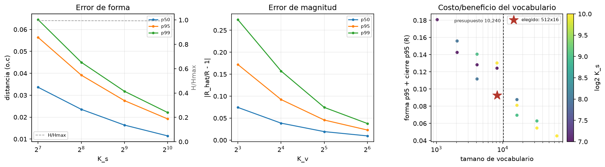

# Barrido del codebook

Generado: `2026-10-19T02:08:45+00:00`  
Fingerprint: `b8be97370673cf71` · Timeframe: `15m`  
Train: 445,299 velas · Validacion: 64,482 velas  
Presupuesto de vocabulario: **10,240** tokens.

## Forma (individual)

Distancia euclidiana de cada vela a su centroide en `(o, c)`.

| k_s | p50 | p95 | p99 | muertos | H/Hmax | seg |
|---|---|---|---|---|---|---|
| 128 | 0.0336 | 0.0564 | 0.0645 | 0 | 0.9949 | 2.1557 |
| 256 | 0.0235 | 0.0392 | 0.0450 | 0 | 0.9939 | 2.7747 |
| 512 | 0.0164 | 0.0275 | 0.0318 | 0 | 0.9933 | 5.5842 |
| 1,024 | 0.0114 | 0.0192 | 0.0221 | 0 | 0.9924 | 11.0793 |

## Magnitud (individual)

Error relativo `|R_hat / R - 1|`.

| k_v | p50 | p95 | p99 | muertos | H/Hmax | seg |
|---|---|---|---|---|---|---|
| 8 | 0.0744 | 0.1721 | 0.2741 | 0 | 0.8946 | 2.5299 |
| 16 | 0.0386 | 0.0924 | 0.1573 | 0 | 0.9082 | 3.7259 |
| 32 | 0.0194 | 0.0457 | 0.0745 | 0 | 0.9271 | 8.5082 |
| 64 | 0.0096 | 0.0230 | 0.0378 | 0 | 0.9396 | 16.0315 |

## Combinaciones (error end-to-end)

`shape_p95` es la distancia media al centroide de forma; `close_p95` es el error del cierre reconstruido, ambos en unidades de R. El objetivo suma los dos: un codebook que solo minimiza el cierre puede destruir la morfologia, que es el proposito del tokenizador.

| k_s | k_v | vocab | shape_p95 | close_p50 | close_p95 | close_p99 | scale_p95 | objetivo |
|---|---|---|---|---|---|---|---|---|
| 128 | 8 | 1,027 | 0.0564 | 0.0428 | 0.1243 | 0.1853 | 0.1714 | 0.1807 |
| 128 | 16 | 2,051 | 0.0564 | 0.0326 | 0.0862 | 0.1159 | 0.0918 | 0.1426 |
| 128 | 32 | 4,099 | 0.0564 | 0.0286 | 0.0718 | 0.0878 | 0.0452 | 0.1282 |
| 128 | 64 | 8,195 | 0.0564 | 0.0273 | 0.0679 | 0.0828 | 0.0231 | 0.1242 |
| 256 | 8 | 2,051 | 0.0392 | 0.0364 | 0.1167 | 0.1829 | 0.1714 | 0.1559 |
| 256 | 16 | 4,099 | 0.0392 | 0.0263 | 0.0725 | 0.1058 | 0.0918 | 0.1117 |
| 256 | 32 | 8,195 | 0.0392 | 0.0212 | 0.0538 | 0.0672 | 0.0452 | 0.0929 |
| 256 | 64 | 16,387 | 0.0392 | 0.0197 | 0.0485 | 0.0586 | 0.0231 | 0.0877 |
| 512 | 8 | 4,099 | 0.0275 | 0.0326 | 0.1130 | 0.1797 | 0.1714 | 0.1405 |
| 512 | 16 | 8,195 | 0.0275 | 0.0215 | 0.0652 | 0.1027 | 0.0918 | 0.0928 |
| 512 | 32 | 16,387 | 0.0275 | 0.0161 | 0.0420 | 0.0560 | 0.0452 | 0.0695 |
| 512 | 64 | 32,771 | 0.0275 | 0.0139 | 0.0353 | 0.0434 | 0.0231 | 0.0628 |
| 1,024 | 8 | 8,195 | 0.0192 | 0.0301 | 0.1111 | 0.1792 | 0.1714 | 0.1303 |
| 1,024 | 16 | 16,387 | 0.0192 | 0.0186 | 0.0619 | 0.1004 | 0.0918 | 0.0811 |
| 1,024 | 32 | 32,771 | 0.0192 | 0.0127 | 0.0354 | 0.0519 | 0.0452 | 0.0546 |
| 1,024 | 64 | 65,539 | 0.0192 | 0.0103 | 0.0263 | 0.0332 | 0.0231 | 0.0454 |

## Recomendacion

Menor `objetivo` con `vocab <= 10,240`: **K_s=512 × K_v=16** → vocabulario **8,195** (forma p95=0.0275, cierre p95=0.0652, objetivo=0.0928 R).

Leer la tabla de combinaciones, no solo las curvas individuales: repartir el mismo presupuesto entre forma y magnitud no da lo mismo. El error del cierre depende del cuerpo (forma) multiplicado por la escala (magnitud), asi que ambos codebooks compiten por el mismo presupuesto.
