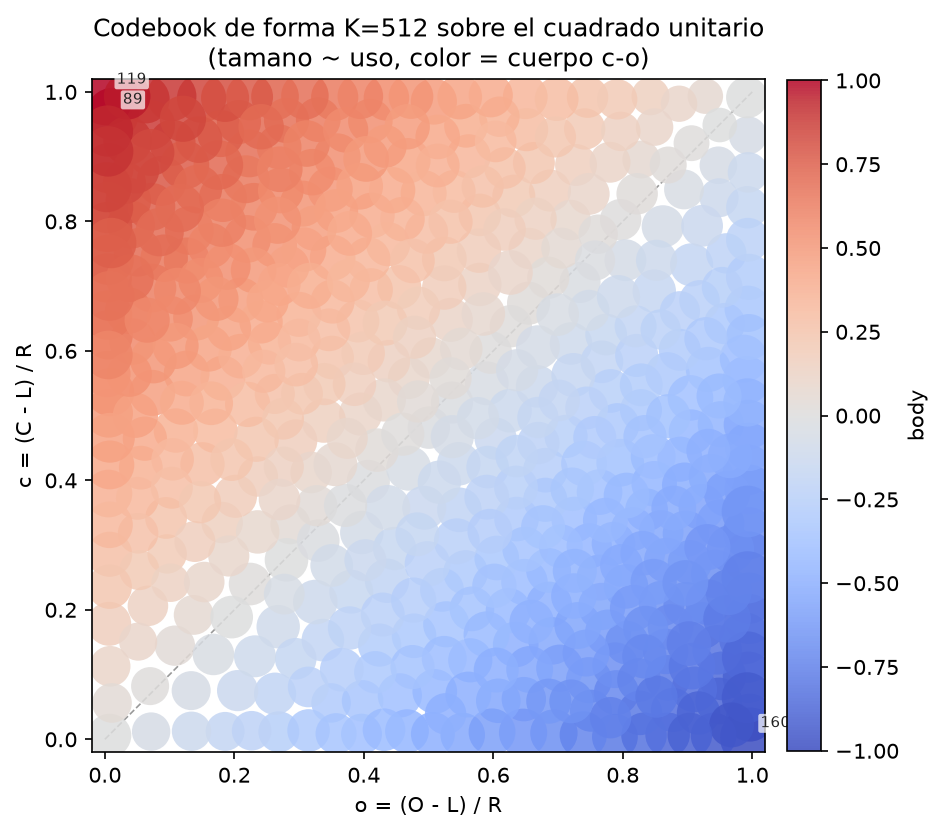
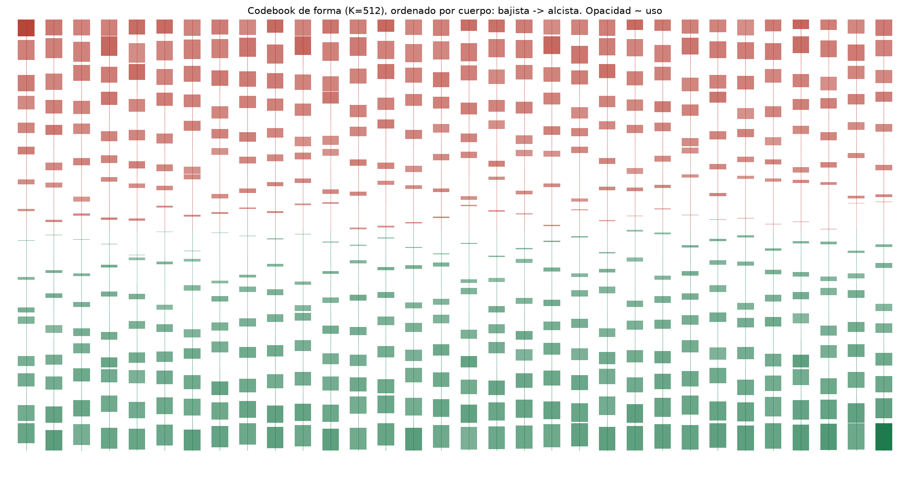
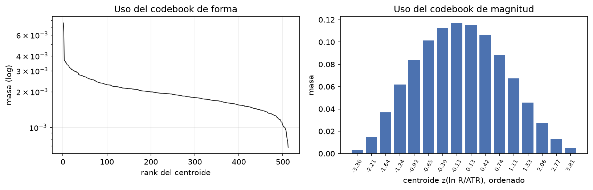
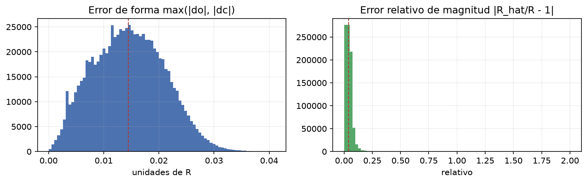
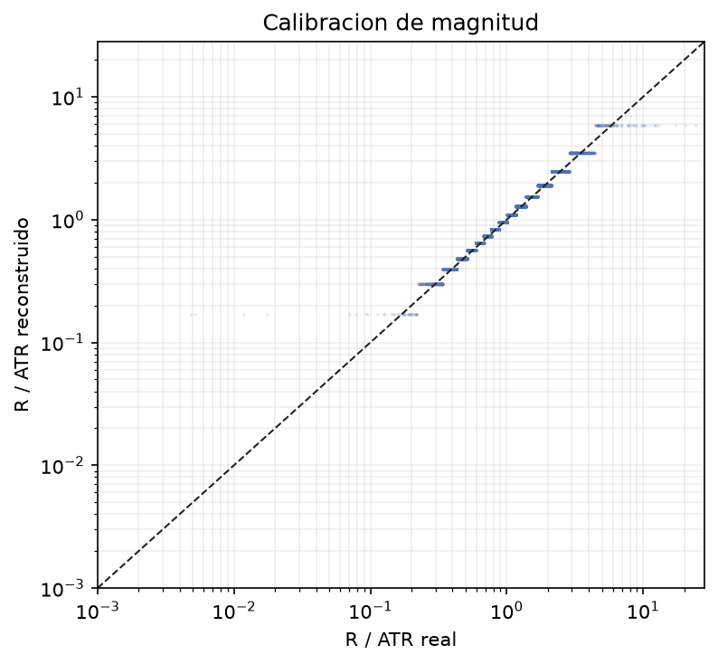
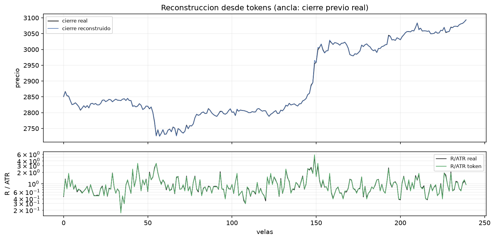
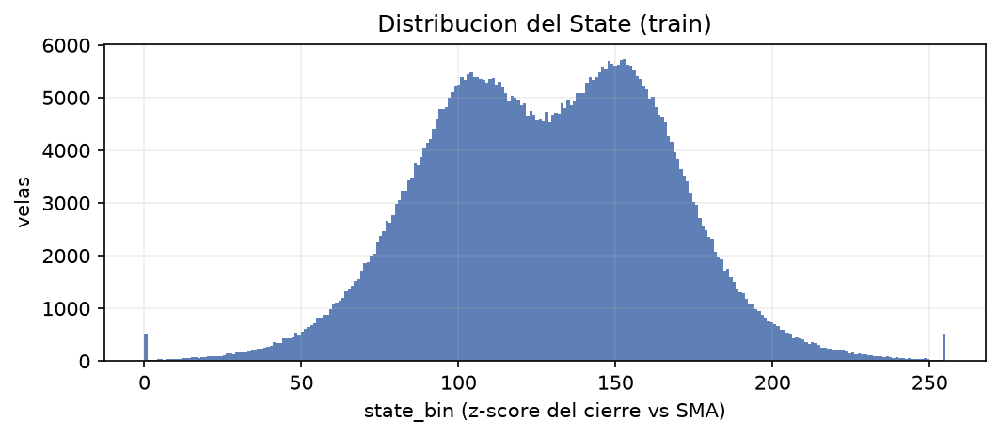

# Reporte del tokenizador de velas

Generado: `2026-10-19T02:07:39+00:00`  
Fingerprint: `b8be97370673cf71`  
Timeframe: `15m` · Simbolos: BTCUSDT, ETHUSDT, SOLUSDT · Fit: BTCUSDT, ETHUSDT · Holdout: SOLUSDT

## 1. Datos

| symbol | bars_1m | bars | flat_pct | train | val | test | gaps |
|---|---|---|---|---|---|---|---|
| BTCUSDT | 4,789,279 | 319,294 | 0.0319 | 222,910 | 32,241 | 58,353 | 32 |
| ETHUSDT | 4,789,278 | 319,294 | 0.0705 | 222,910 | 32,241 | 58,353 | 32 |
| SOLUSDT | 3,226,695 | 215,115 | 0.0065 | 118,731 | 32,241 | 58,353 | 10 |

Velas 1m: 12,805,252 · Velas 15m: 853,703 · Embargo: 2,895 velas al inicio de val/test.

## 2. Codebook

| K_forma | K_magnitud | vocab | muertos_forma | muertos_mag | H/Hmax_forma | H/Hmax_mag | cobertura_forma | silhouette | prune_rounds | puntos_fit |
|---|---|---|---|---|---|---|---|---|---|---|
| 512 | 16 | 8,195 | 0 | 0 | 0.9933 | 0.9082 | 1.0000 | 0.2804 | 0 | 445,299 |

El vocabulario se factoriza: `token = 3 + shape_id * K_magnitud + mag_id`. La embedding puede implementarse como suma de dos tablas, lo que comparte estructura entre formas similares y reduce parametros.

## 3. Calidad de reconstruccion

Errores en unidades de R (rango de la vela), calculados sobre velas no planas. `close_p95` es el error del cierre reconstruido anclando en el cierre previo real. `close_p95_bps` y `gap_p99_bps` estan en puntos base (1 bp = 0.01%): son la unidad estable cuando R es apenas un tick.

| split | n | shape_p50 | shape_p95 | shape_p99 | mag_p50 | mag_p95 | close_p95 | close_p95_bps | gap_p50 | gap_p99 | gap_p99_bps |
|---|---|---|---|---|---|---|---|---|---|---|---|
| train | 564,168 | 0.0146 | 0.0253 | 0.0295 | 0.0386 | 0.0915 | 0.1406 | 11.2110 | 8.22e-04 | 0.3387 | 24.8742 |
| val | 96,723 | 0.0144 | 0.0251 | 0.0292 | 0.0383 | 0.0894 | 0.0655 | 4.8630 | 0.0000 | 0.0286 | 0.9636 |
| test | 175,059 | 0.0143 | 0.0252 | 0.0294 | 0.0386 | 0.0911 | 0.0708 | 4.3271 | 0.0000 | 0.0625 | 1.3478 |

Errores de reconstruccion con OHLC invalido: 0 velas.

## 4. Transferencia por simbolo

| symbol | role | split | n | shape_p50 | shape_p95 | mag_p50 | mag_p95 | close_p95 | close_p95_bps | gap_p99 | gap_p99_bps | shape_codes | recon_invalid |
|---|---|---|---|---|---|---|---|---|---|---|---|---|---|
| BTCUSDT | fit | train | 222,794 | 0.0146 | 0.0253 | 0.0385 | 0.0918 | 0.1212 | 8.1278 | 0.3295 | 21.5622 | 512 | 0 |
| BTCUSDT | fit | val | 32,241 | 0.0140 | 0.0249 | 0.0388 | 0.0930 | 0.0660 | 3.6250 | 4.13e-04 | 0.0024 | 512 | 0 |
| BTCUSDT | fit | test | 58,353 | 0.0138 | 0.0250 | 0.0393 | 0.0959 | 0.0687 | 3.0169 | 9.61e-04 | 0.0280 | 512 | 0 |
| ETHUSDT | fit | train | 222,671 | 0.0146 | 0.0253 | 0.0388 | 0.0931 | 0.1247 | 10.3816 | 0.3442 | 27.0474 | 512 | 0 |
| ETHUSDT | fit | val | 32,241 | 0.0145 | 0.0253 | 0.0384 | 0.0907 | 0.0645 | 4.3599 | 0.0055 | 0.2283 | 512 | 0 |
| ETHUSDT | fit | test | 58,353 | 0.0145 | 0.0253 | 0.0386 | 0.0912 | 0.0639 | 4.5632 | 0.0057 | 0.1280 | 512 | 0 |
| SOLUSDT | holdout | train | 118,703 | 0.0145 | 0.0252 | 0.0384 | 0.0882 | 0.1859 | 16.3806 | 0.3462 | 26.0292 | 512 | 0 |
| SOLUSDT | holdout | val | 32,241 | 0.0147 | 0.0252 | 0.0378 | 0.0839 | 0.0659 | 6.1964 | 0.0385 | 1.1053 | 512 | 0 |
| SOLUSDT | holdout | test | 58,353 | 0.0147 | 0.0254 | 0.0378 | 0.0860 | 0.0784 | 5.2075 | 0.0909 | 1.4531 | 512 | 0 |

## 5. Patrones canonicos

Cada patron se busca como punto en el cuadrado unitario y se asigna a su centroide mas cercano. IDs distintos y distancias bajas indican que el codebook separa las morfologias conocidas.

| pattern | o | c | shape_id | dist | centroid_o | centroid_c | body |
|---|---|---|---|---|---|---|---|
| marubozu_bull | 0.0000 | 1.0000 | 119 | 0.0039 | 0.0022 | 0.9968 | 0.9946 |
| marubozu_bear | 1.0000 | 0.0000 | 160 | 0.0043 | 0.9966 | 0.0027 | -0.9939 |
| doji_center | 0.5000 | 0.5000 | 18 | 0.0186 | 0.5005 | 0.4814 | -0.0191 |
| doji_low | 0.2000 | 0.2000 | 315 | 0.0120 | 0.1959 | 0.1888 | -0.0071 |
| hammer | 0.8500 | 0.8500 | 456 | 0.0287 | 0.8222 | 0.8427 | 0.0204 |
| shooting_star | 0.1500 | 0.1500 | 92 | 0.0260 | 0.1678 | 0.1311 | -0.0367 |
| spinning_top | 0.4500 | 0.5500 | 82 | 0.0210 | 0.4694 | 0.5580 | 0.0885 |

## 6. Tokens mas frecuentes (train)

| shape_id | o | c | body | usage_pct | top_mag |
|---|---|---|---|---|---|
| 119 | 0.0022 | 0.9968 | 0.9946 | 0.7585 | 7 |
| 160 | 0.9966 | 0.0027 | -0.9939 | 0.6342 | 8 |
| 89 | 0.0118 | 0.9657 | 0.9539 | 0.3708 | 9 |
| 409 | 0.9929 | 0.2501 | -0.7427 | 0.3646 | 9 |
| 117 | 0.9948 | 0.3184 | -0.6763 | 0.3612 | 7 |
| 200 | 0.9946 | 0.2811 | -0.7135 | 0.3565 | 8 |
| 66 | 0.9887 | 0.1560 | -0.8327 | 0.3506 | 9 |
| 402 | 0.9927 | 0.3519 | -0.6408 | 0.3488 | 9 |
| 300 | 0.9928 | 0.1269 | -0.8660 | 0.3414 | 8 |
| 56 | 0.9950 | 0.2179 | -0.7771 | 0.3361 | 10 |
| 397 | 0.0043 | 0.8213 | 0.8171 | 0.3356 | 8 |
| 345 | 0.0041 | 0.9396 | 0.9356 | 0.3352 | 8 |

## 7. State

`State = Quantize((C - SMA_M) / sigma_M)`, con bins de igual ancho sobre el rango clip de train. El canal `scale = ln(ATR/ATR_long)` se guarda sin tokenizar; es el ancla de volatilidad que el decoder necesita.

## 8. Criterios de aceptacion

| criterio | valor | estado |
|---|---|---|
| Error de forma mediano < 0.02 R | 0.0143 | PASS |
| Error de forma p95 < 0.08 R | 0.0252 | PASS |
| Error de cierre p95 < 5 bps | 4.3271 | PASS |
| Centroides muertos < 2% | 0.00% | PASS |
| Entropia de uso normalizada > 0.60 | 0.9933 | PASS |
| Cobertura del codebook en train > 98% | 100.0% | PASS |
| Cobertura de codigos en holdout SOLUSDT > 90% | 100.0% | PASS |

## 9. Limitaciones conocidas

- El token no captura el gap de apertura (`open - prev_close`). Se mide en `gap_p99_bps`; si es material, hace falta un tercer codebook o un feature de gap. El p99 en unidades de R se infla en velas de rango minimo y no debe leerse solo.
- El token es contextual: depende del ATR de las ultimas k velas, por lo que la misma vela puede tokenizar distinto en otro contexto. El ATR se guarda en el dataset para poder decodificar.
- Sin `scale`, los tokens no permiten reconstruir volatilidad absoluta ni nivel de precio: solo forma relativa.
- K-Means minimiza error cuadratico, no verosimilitud: los centroides se concentran donde hay masa, no donde hay patrones raros. Los patrones extremos pueden compartir token.
