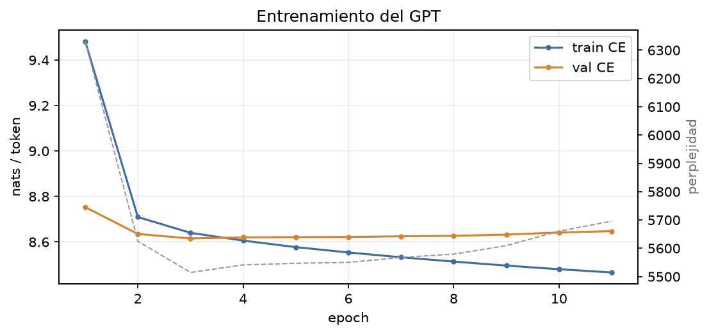
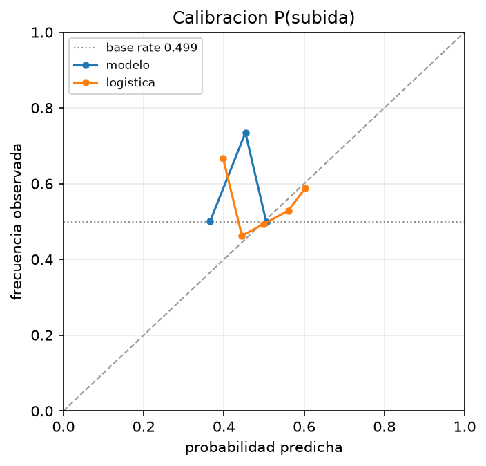
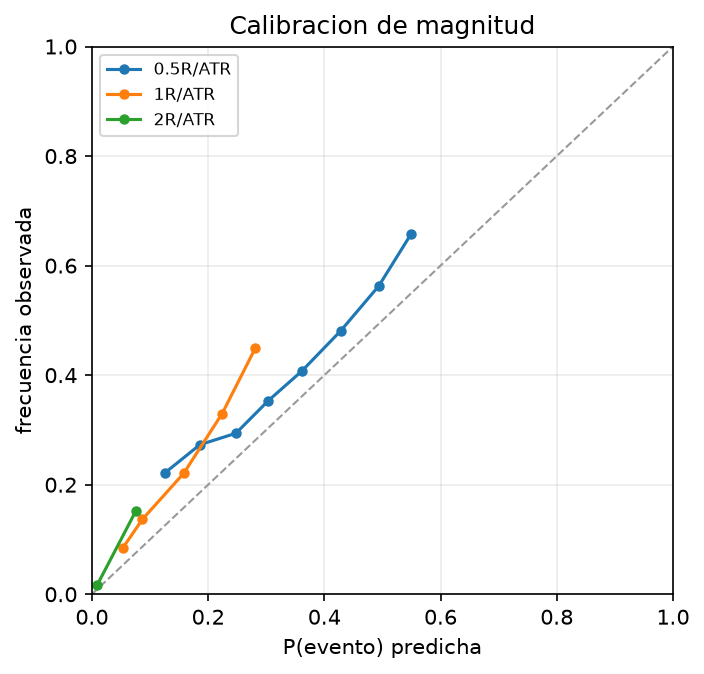
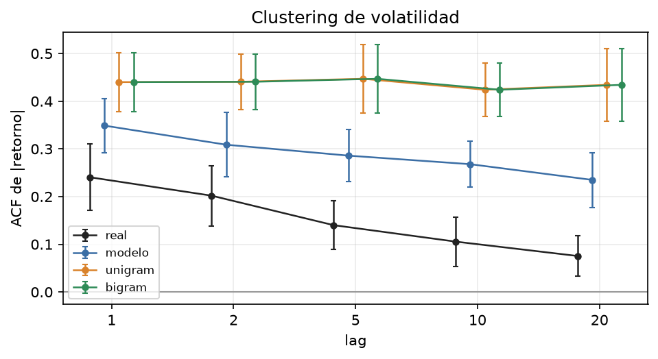
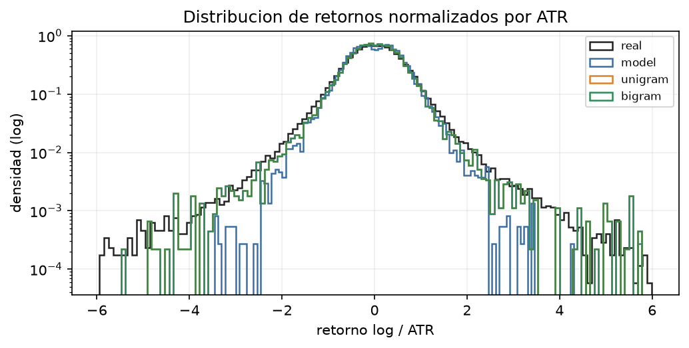
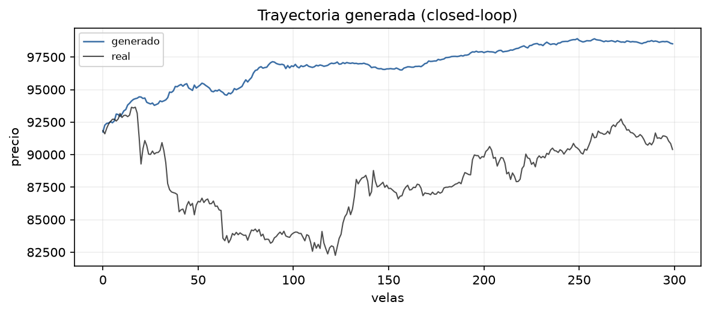

# PoC del transformer de velas

Generado: `2026-10-19T02:45:13+00:00`  
Tokenizer fingerprint: `b8be97370673cf71`  
Checkpoint epoch: 3 · val CE: 8.6152  
Modelo: d_model=128, layers=4, heads=4, seq_len=256, params=997,268  
Datos: train=440,036 velas (BTC/ETH), val=64,482, test=175,059 (BTC/ETH/SOL; SOL holdout).  
Tokenizer: 512×16 (8195 tokens), magnitud normalizada con `ATR_{t-1}` (error de cierre ~4.3 bps).

## 1. One-step

| split | n | ce_nats | bits | ppl | top1 |
|---|---|---|---|---|---|
| val | 64,000 | 8.6152 | 12.4291 | 5514.6676 | 9.69e-04 |
| test | 174,336 | 8.6199 | 12.4359 | 5540.9366 | 8.95e-04 |

Se comparan los mismos targets (ventanas no solapadas, stride=seq_len; el remanente que no completa una ventana queda fuera). `top1` es la accuracy del token conjunto; con 8195 tokens y una distribucion ancha es una metrica poco informativa: el token mas frecuente del train tiene ~0.76% de masa. La metrica principal es CE.

| metodo | symbol | n | ce_nats | bits | ppl |
|---|---|---|---|---|---|
| modelo | BTCUSDT | 58,112 | 8.6201 | 12.4362 | 5541.8931 |
| modelo | ETHUSDT | 58,112 | 8.6388 | 12.4632 | 5646.7796 |
| modelo | SOLUSDT | 58,112 | 8.6008 | 12.4084 | 5436.1442 |
| unigram | BTCUSDT | 58,112 | 8.6744 | 12.5145 | 5851.1655 |
| unigram | ETHUSDT | 58,112 | 8.6714 | 12.5103 | 5833.9300 |
| unigram | SOLUSDT | 58,112 | 8.6250 | 12.4433 | 5569.2174 |
| bigram | BTCUSDT | 58,112 | 8.6744 | 12.5145 | 5851.1655 |
| bigram | ETHUSDT | 58,112 | 8.6714 | 12.5103 | 5833.9300 |
| bigram | SOLUSDT | 58,112 | 8.6250 | 12.4433 | 5569.2174 |

El bigrama se **apaga a λ=0**: con 445k transiciones para 8195² pares posibles no hay estructura de orden 1 explotable y el tuning lo colapsa al unigram. La mejora del transformer, si existe, viene de contexto/estado, no de pares adyacentes.

## 2. Calibracion

Direccion: tasa base de subida en test = 0.4986. El modelo agrega P(subida) sumando las probabilidades de las formas con c>o.

| metodo | brier | ece | logloss | acc | n |
|---|---|---|---|---|---|
| modelo | 0.2500 | 0.0072 | 0.6931 | 0.5048 | 174,336 |
| logistica | 0.2498 | 0.0183 | 0.6927 | 0.5223 | 174,336 |

Magnitud: P(|cuerpo|·R/ATR > umbral), sumando tokens compatibles.

| umbral_R_ATR | base_rate | model_brier | model_ece | model_logloss | unigram_p | unigram_brier | n |
|---|---|---|---|---|---|---|---|
| 0.5000 | 0.3873 | 0.2356 | 0.0497 | 0.6643 | 0.3546 | 0.2384 | 174,336 |
| 1.0000 | 0.1161 | 0.1023 | 0.0416 | 0.3606 | 0.0983 | 0.1030 | 174,336 |
| 2.0000 | 0.0176 | 0.0172 | 0.0082 | 0.0875 | 0.0169 | 0.0173 | 174,336 |

## 3. Closed-loop

Se generan 2000 velas por muestra, 4 muestras por prompt, 2 prompts por simbolo. El decoder recompone ATR, State y Scale despues de cada vela. Los baselines usan el mismo decoder y el mismo feedback; solo cambia el sampler. Los retornos se normalizan por **ATR relativo** (`ATR/precio`), no por el ATR en unidades de precio: eso los hace comparables entre BTC, ETH y SOL.

| metodo | acf1 | acf2 | acf5 | acf10 | acf20 | kurtosis | leverage | q01 | q99 | hill | hurst |
|---|---|---|---|---|---|---|---|---|---|---|---|
| real | 0.2406 ± 0.0698 | 0.2019 ± 0.0633 | 0.1401 ± 0.0509 | 0.1056 ± 0.0517 | 0.0755 ± 0.0429 | 14.3001 ± 16.0153 | -0.0248 ± 0.0562 | -1.9131 ± 0.1840 | 1.8994 ± 0.2146 | 3.0605 ± 0.4165 | 0.5435 ± 0.0272 |
| modelo | 0.3488 ± 0.0569 | 0.3088 ± 0.0674 | 0.2859 ± 0.0544 | 0.2679 ± 0.0476 | 0.2350 ± 0.0574 | 10.6892 ± 8.6191 | -0.0092 ± 0.0629 | -1.4235 ± 0.0561 | 1.4535 ± 0.0481 | 4.1803 ± 0.3527 | 0.5406 ± 0.0387 |
| unigram | 0.4401 ± 0.0618 | 0.4408 ± 0.0586 | 0.4470 ± 0.0724 | 0.4240 ± 0.0566 | 0.4343 ± 0.0766 | 41.6477 ± 31.9621 | 0.0084 ± 0.0384 | -1.7022 ± 0.1038 | 1.6538 ± 0.0800 | 3.0383 ± 0.2884 | 0.6230 ± 0.0962 |
| bigram | 0.4401 ± 0.0618 | 0.4408 ± 0.0586 | 0.4470 ± 0.0724 | 0.4240 ± 0.0566 | 0.4343 ± 0.0766 | 41.6477 ± 31.9621 | 0.0084 ± 0.0384 | -1.7022 ± 0.1038 | 1.6538 ± 0.0800 | 3.0383 ± 0.2884 | 0.6230 ± 0.0962 |

La fila `bigram` es identica a `unigram`: el tuning eligio λ=0 porque no hay estructura de orden 1 explotable. Se mantiene como control.

Estadisticos sobre retornos logaritmicos; `q01`/`q99` y `hill` usan retornos normalizados por ATR relativo. `hill` alto = cola mas fina.

## 4. Hallazgos

- **CE**: 8.6199 nats/token en test, -0.037 nats vs unigram (8.6570). La mejora es chica y el modelo empieza a overfitear en la epoch 3: el cuello de botella es el tamano de datos, no la arquitectura.
- **Transferencia**: SOL (holdout) da CE 8.6008, similar a BTC/ETH. El tokenizer y el modelo no dependen de un simbolo particular; el holdout no se degrada.
- **Direccion**: Brier 0.2500 vs 0.2500 de la tasa base. Calibrado (ECE 0.0072) pero sin skill direccional a 15m. La logistica tiene accuracy algo mayor (0.522 vs 0.505) pero Brier practicamente identico (0.2498).
- **Magnitud**: el modelo mejora apenas al unigram en Brier (0.2356 vs 0.2384 para |cuerpo| > 0.5 R/ATR); la senal esta en la magnitud, no en la direccion.
- **Closed-loop**: el modelo reproduce mejor que los baselines la persistencia de corto plazo (ACF1 0.349 vs 0.440/0.440; real 0.241) y el Hurst (0.541 vs 0.544 real), pero sigue siendo demasiado persistente (ACF5 0.286 vs 0.140 real) y de cola mas fina (Hill 4.18 vs 3.06). El unigram acierta el Hill (3.04) pero dispara la kurtosis (41.6 vs 14.3 real); el modelo queda mas cerca en kurtosis (10.7).

## 5. Limitaciones

- **Datos chicos**: ~440,036 tokens de train y ~1,718 ventanas independientes de 256 velas. El modelo es deliberadamente chico (997,268 parametros). La CE de test mejora al unigram solo 0.43% y empeora a partir de la epoch 3.
- **Top-1 vs CE**: CE mejora al unigram pero top-1 es 0.09%, peor que predecir siempre el token mas frecuente (~0.76%). Con una distribucion ancha, el modo del modelo no es el modo empirico. No usar top-1 como criterio principal.
- **Direccion**: el Brier es 0.2500, practicamente igual al de la tasa base (0.2500). A 15m la direccion del siguiente cierre es casi impredecible con este modelo; la calibracion es buena (ECE 0.0072) pero la informacion es nula.
- **Colas y persistencia**: el modelo subrepresenta tokens de magnitud extrema. La trayectoria generada es mas suave y de cola mas fina que la real (Hill 4.18 vs 3.06), y el ACF de |retorno| decae demasiado lento (ACF5 0.286 vs 0.140). El unigram preserva la cola (Hill 3.04) pero sobreestima la kurtosis (41.6 vs 14.3). Ningun sampler reproduce bien las dos cosas a la vez; el feedback del ATR agrega persistencia por construccion.
- **Cabeza factorizada**: asume independencia condicional forma/magnitud dado el estado oculto. La correlacion real cuerpo-volatilidad se captura solo a traves de h.
- **Cola truncada del tokenizer**: el codebook de magnitud satura en ~4.1 R/ATR; los crashes reales llegan a ~8.8. La generacion no puede producir esas colas aunque el sampler las pida.
- **Gap no modelado**: el decoder ancla O=prev_close; el gap real p99 es ~1-2 bps, chico pero no cero.
- **Exposure bias**: en training State/Scale son reales; en closed-loop se recalculan. Se agrego ruido en training, no scheduled sampling.
- **Contexto de 256 velas** (~2.7 dias): no captura estacionalidad semanal.
